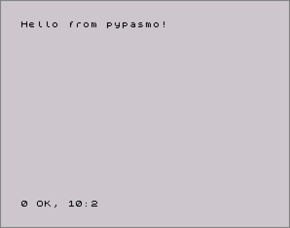

# ZX Spectrum 48K

Back to the [index](../index.md).

The ZX Spectrum 48K is the main target of Pasmo and pypasmo. pypasmo makes tapes with or
without a Basic loader (the same bytes as Pasmo 0.5.5), tapes with several blocks and a
loading screen, snapshots that run at once, and debug data for stepping through the
source in VS Code. The 128K with its RAM banks and the +3 disk are on their own page:
[ZX Spectrum 128K and +3](zx-spectrum-128k.md).

- [Quick start](#quick-start)
- [Which output to choose](#which-output-to-choose)
- [Tapes](#tapes)
- [Several blocks on a tape](#several-blocks-on-a-tape)
- [Joining .tap files](#joining-tap-files)
- [Snapshots](#snapshots)
- [Debugging in VS Code with DeZog](#debugging-in-vs-code-with-dezog)
- [Trying it in an emulator](#trying-it-in-an-emulator)
- [Example files](#example-files)
- [All ZX Spectrum 48K options](#all-zx-spectrum-48k-options)

## Quick start

`hello.asm` clears the screen, prints a text with the ROM and returns to Basic:

```
        org 8000h       ; the code starts at 8000h = 32768
start:  call 0D6Bh      ; ROM: clear the screen
        ld a,2          ; channel 2 = the upper screen
        call 1601h      ; ROM: open the channel
        ld hl,text
next:   ld a,(hl)
        or a            ; 0 = end of the text
        ret z           ; back to Basic: "0 OK"
        rst 10h         ; ROM: print the character in A
        inc hl
        jr next
text:   db "Hello from pypasmo!", 13, 0
        end start
```

`END start` gives the entry point, the address where the program starts; without it the
loaders and snapshots do not start the code.

### 1. A snapshot: the quickest way to try it

```
python -m pypasmo --sna-48k hello.asm hello.sna
```

Open `hello.sna` in an emulator, for example drag it into the window of
[JSSpeccy](https://jsspeccy.zxdemo.org/) in a web browser. The program runs at once,
without loading:



`0 OK, 10:2` is the report of Basic after the `RET`: the snapshot holds a small Basic
program whose line 10 called the code (see [Snapshots](#snapshots)).

### 2. A tape with a Basic loader

```
python -m pypasmo --tap-wloader-48k --name hello hello.asm hello.tap
```

Open it in an emulator and type `LOAD ""` (most emulators do it themselves). The
Spectrum loads `Program: loader` and `Bytes: hello`, then the program runs: the same text,
and `0 OK, 40:1` from the line of the loader that called the code.

### 3. The code only, for your own loader

```
python -m pypasmo --tap-48k --name hello hello.asm hello.tap
```

This is `--tap` of Pasmo: a CODE block without a loader. Load it by hand with
`CLEAR 32767: LOAD "" CODE`, then run it with `RANDOMIZE USR 32768` (32768 = 8000h).

`--tzx-wloader-48k` / `--tzx-48k` write the same blocks into a `.tzx` file,
`--pzx-wloader-48k` / `--pzx-48k` into a `.pzx` file, `--z80-48k` writes the snapshot as
`.z80`. With `pip install .` the command is just `pypasmo`
instead of `python -m pypasmo`.

## Which output to choose

| You want | Option | See |
|---|---|---|
| a tape that loads and runs with `LOAD ""` (48K, also on the 128K, +2, +3) | <nobr>`--tap-wloader-48k`</nobr> (or <nobr>`--tzx-wloader-48k`</nobr>) | [Tapes](#tapes) |
| a tape with a loading screen | `TAPE_BLOCK_SCREEN` + <nobr>`--tap-wloader-48k`</nobr> | [TAPE_BLOCK_SCREEN](#tape_block_screen) |
| a tape for your own Basic loader | <nobr>`--tap-48k`</nobr> (or <nobr>`--tzx-48k`</nobr>), maybe with `TAP_INCLUDE` | [Tapes](#tapes) |
| to put your own loader or more programs before / after the code | join `.tap` files | [Joining .tap files](#joining-tap-files) |
| to try it at once, no loading (also for DeZog) | <nobr>`--sna-48k`</nobr> (or <nobr>`--z80-48k`</nobr>) | [Snapshots](#snapshots) |
| stepping and breakpoints in the `.asm` in VS Code | <nobr>`--sna-48k`</nobr> + <nobr>`--dbgsym-sld`</nobr> | [DeZog](#debugging-in-vs-code-with-dezog) |
| code in the 128K RAM banks (`BANK`), a +3 disk | <nobr>`--tap-wloader-128k`</nobr>, <nobr>`--sna-128k`</nobr>, <nobr>`--dsk-plus3`</nobr> ... | [ZX Spectrum 128K and +3](zx-spectrum-128k.md) |

## Tapes

Without `TAPE_BLOCK` the tape formats write one block with all the code, from the lowest to
the highest used address, as Pasmo does. Code that fills the whole 64 KB is an error
(Pasmo writes a header with length 0).

- `--tap-48k` (also `--tap`): a CODE header and a data block (`LOAD "" CODE`).
- `--tap-wloader-48k` (also `--tapbas`): the Basic loader `loader` before them.
- `--tzx-48k`, `--tzx-wloader-48k` (also `--tzx`, `--tzxbas`): the same blocks in a
  `.tzx` file (standard speed blocks, 1 s pause).
- `--pzx-48k`, `--pzx-wloader-48k` *(pypasmo extension, early version)*: the same blocks
  in a `.pzx` file (the format of Patrik Rak, version 1.0): each block as the pulses of
  the ROM loader (pilot tone, sync, the bits), then a pause of 1 s, as on a real tape.
  Fuse and ZEsarUX open it.

### The Basic loader

`--tap-wloader-48k`, `--tzx-wloader-48k` and `--pzx-wloader-48k` write this program
(autostart at line 10):

```
10 CLEAR <lowest address - 1>
20 POKE 23610,255
30 LOAD "" CODE
40 RANDOMIZE USR <address from END>      (only if END has an argument)
```

It is byte for byte the same as `spectrum.cxx` in Pasmo. For the quick start example it is
`10 CLEAR 32767` ... `40 RANDOMIZE USR 32768`. With `TAPE_BLOCK` the loader loads the
listed blocks, see [Several blocks on a tape](#several-blocks-on-a-tape).

### CLEAR and RAMTOP

`CLEAR n` sets RAMTOP to n: Basic keeps its stack and variables below it, so the code
above it is safe. The loader does `CLEAR` to one byte below the lowest address of the code.

- The ROM refuses a `CLEAR` lower than about 157 bytes above the end of the loader, so
  the code should start at about 5DB0h or higher ("M RAMTOP no good" or
  "4 Out of memory" otherwise; measured in the simulator of SkoolKit). The examples use
  8000h.
- Code in the video RAM makes the lowest address too low as well; put a loading screen
  on the tape with [`TAPE_BLOCK_SCREEN`](#tape_block_screen) (the screen does not count for
  `CLEAR`).
- Code in the ROM (0000h-3FFFh) can not be loaded there.

### Warnings of the tape loaders

*(pypasmo)* pypasmo warns (the file is written all the same) when the loader can not
work: a `CLEAR` too low (see above; also for the `TAPE_BLOCK` and 128K loaders and the
`DISK` loader of `--dsk-plus3`) and code in the ROM (on any tape). `--werror` makes the
warnings errors.

### The name on the tape

The name in the CODE header is `--name` (max. 10 characters) or the output file name as
given on the command line (with a path, `build/game.tap`, the name gets the directory too,
so use `--name` then); the Basic loader is always `loader`. See
[Header name](../command-line.md#header-name). `TAPE_BLOCK` blocks have their own names.

## Several blocks on a tape

*(pypasmo extension)* `TAPE_BLOCK`, `TAPE_BLOCK_SCREEN` and `TAP_INCLUDE` make a tape with
several blocks, each with its own name, e.g. a loading screen and the code. With them
the tape formats (`--tap-48k`, `--tzx-48k`, `--pzx-48k` and their `-wloader-` variants)
write only the listed blocks, in the order of the directives, and `--tap-wloader-48k`,
`--tzx-wloader-48k` and `--pzx-wloader-48k` make a loader with one `LOAD` line for each
block.

The directives can be anywhere in the source, also at the start before the labels they
use (the values come from the last pass), or in an own file that `INCLUDE`s the program.
The other formats (`--bin`, `--sna-48k`, ...) ignore them; the 128K tapes (`--tap-128k`,
`--tap-wloader-128k`, `--tzx-128k` ...) with them are an error (not done yet).

### TAPE_BLOCK

```
        tape_block "name", start, length
```

puts `length` bytes of the assembled code from the address `start` on the tape: a CODE
header (type 3, the name, `start`, `length`) and a data block, loaded with
`LOAD "" CODE`. The name has at most 10 characters (a longer one is an error); `--name`
is not used. For example a program with its data in two blocks:

```
        org 8000h
start:  ...                         ; the program
end_code:

        org 0C000h
level:  incbin "level1.bin"         ; data
end_level:

        tape_block "game", start, end_code - start
        tape_block "level", level, end_level - level
        end start
```

### TAPE_BLOCK_SCREEN

`TAPE_BLOCK_SCREEN` puts a loading screen on the tape: a CODE block of 6912 bytes from
4000h (bitmap + attributes), which the loader loads with `LOAD "" SCREEN$`. It is written
in one of two ways.

**With one parameter**, `TAPE_BLOCK_SCREEN "name"`, it is the same as
`TAPE_BLOCK "name", 4000h, 6912`: the picture must be in the assembled code already, put
there with `ORG 4000h` and `INCBIN`. A warning when the code does not fill all of
4000h-5AFFh (a missing `INCBIN`):

```
        org 4000h
        incbin "picture.scr"        ; 6912 bytes: bitmap + attributes
        org 8000h
start:  ...
        tape_block_screen "picture"
        tape_block "game", start, $ - start
        end start
```

**With two parameters**, `TAPE_BLOCK_SCREEN "name", "file.scr"`, it reads the picture file
itself and puts it at 4000h-5AFFh, as `ORG 4000h` + `INCBIN` would, but `$` does not move,
so the line can be anywhere in the program. The file must have exactly 6912 bytes (else
an error), and code at 4000h-5AFFh (before or after the line) is an error. The file name
is read as in `INCLUDE`.

In both ways the picture is in the memory: `--sna-48k` shows it, `--bin` starts at 4000h.

**Example**: `picture.scr` is a screen file of 6912 bytes (e.g. saved from an emulator or
a graphics editor):

```
        org 8000h
start:  ld a,2
        call 1601h      ; ROM: open channel 2 (the upper screen)
        ld hl,text
next:   ld a,(hl)
        or a
        ret z
        rst 10h
        inc hl
        jr next
text:   db "Hello after the picture", 13, 0

        tape_block_screen "screen", "picture.scr"
        tape_block "game", start, $ - start
        end start
```

```
python -m pypasmo --tap-wloader-48k game.asm game.tap
```

The tape: `loader`, `screen` (6912 bytes for 4000h), `game` (the code). The loader:

```
10 CLEAR 32767                       (lowest block - 1, the screen does not count)
20 POKE 23610,255
30 LOAD "" SCREEN$: POKE 23739,111
40 LOAD "" CODE
50 POKE 23739,244: RANDOMIZE USR 32768
```

`POKE 23739,111` stops the "Bytes: name" messages that would spoil the picture;
`POKE 23739,244` sets the ROM value again before the program runs (else `RST 10h`
prints nothing). Without a screen block there are no POKE 23739, without `END address`
no `RANDOMIZE USR`.

The directives are also listed in [Directives](../directives.md#pypasmo-directives).

### TAP_INCLUDE

`TAP_INCLUDE file` puts the blocks of an existing `.tap` file unchanged on the tape, at
its place among the `TAPE_BLOCK` blocks: an own Basic loader (saved in an emulator or made
by another tool), UDG or other data. The file name is read as in `INCLUDE`; the file must
be a correct `.tap` (block lengths and checksums are checked).

```
        tap_include "loader.tap"    ; own Basic loader: use --tap-48k
        tape_block_screen "picture"
        tape_block "game", start, $ - start
        tap_include "udg.tap"
```

- `--tap-48k` / `--tzx-48k` / `--pzx-48k`: no generated loader; the own loader must load the blocks in
  this order.
- `--tap-wloader-48k` / `--tzx-wloader-48k` / `--pzx-wloader-48k`: the generated loader is first, as always, and
  has a `LOAD "" CODE` for each included CODE block too (an included CODE 16384,6912 is a
  screen: `LOAD "" SCREEN$`). Other included blocks (Basic, arrays, headerless) get no
  line; two loaders on one tape are the programmer's business.

## Joining .tap files

A `.tap` file is only a row of tape blocks one after another, with nothing before or
after them. So two or more `.tap` files joined into one file are a correct tape: the
blocks of the first file, then the blocks of the second. The emulator loads them in this
order, as from a real tape (each `LOAD ""` takes the next file).

This is useful, for example, for an own Basic loader (saved from an emulator, or made with
a tool such as zmakebas or bas2tap) and the code made by pypasmo with `--tap-48k` (a tape
without the generated loader). Here `loader.tap` holds a Basic program with autostart that
does `CLEAR 32767: LOAD "" CODE: RANDOMIZE USR 32768`.

The code without a loader:

```
python -m pypasmo --tap-48k --name game game.asm game.tap
```

Joining the files in the Windows command line (`cmd`):

```
copy /b loader.tap + game.tap full.tap
```

`/b` (binary) is needed: without it `copy` takes the files as text and adds the byte 1Ah
(end of text) to the end of `full.tap`. More files: `copy /b a.tap + b.tap + c.tap all.tap`.

Joining the files in Linux or macOS (bash):

```
cat loader.tap game.tap > full.tap
```

- The order of the files is the order on the tape; the loader must load the blocks in
  this order.
- The same works with the output of `--tap-wloader-48k`: blocks added after it are not
  loaded by the generated loader, but the program can load them itself (or the user with
  `LOAD ""`).
- `TAP_INCLUDE` does the same inside the source and also checks the included file, see
  [above](#tap_include).
- `.tzx` files can not be joined like this: a `.tzx` starts with its own header
  (`ZXTape!`), so joining needs a TZX tool. Simpler: use `TAP_INCLUDE` with `--tzx-48k`
  (it puts the blocks of a `.tap` into the `.tzx`).

## Snapshots

*(pypasmo extension)* `--sna-48k` and `--z80-48k` write a snapshot: it opens in an
emulator and runs at once, without loading a tape. (`--sna-128k` and `--z80-128k` are
described in [128K snapshots](zx-spectrum-128k.md#128k-snapshots).)

### The state of a snapshot

The snapshot holds the state of a Spectrum whose Basic program did `CLEAR start-1` (like
`--tap-wloader-48k`) and has just called the entry point (`END address`, else the start of
the code) with `RANDOMIZE USR`:

- the system variables are valid, so the ROM routines (`RST 10h`, ...) work, and `RET`
  returns to Basic (`0 OK`);
- the screen is cleared (white paper, black ink), the border white, interrupts on in
  mode 1;
- if the code starts below 5D2Ah (the lowest `CLEAR` here), RAMTOP stays at FF57h.

`.sna` and `.z80` hold the same state. `.z80` (version 3, machine 48K) has PC in the
header and the RAM compressed (smaller files); `.sna` has PC pushed on the stack, because
the format has no PC.

### Snapshot errors

pypasmo gives an error instead of a snapshot that would not work:

- code in the ROM (0000h-3FFFh);
- code where the Basic stack must be (about 26 bytes below RAMTOP);
- code over the system variables and the Basic program (5C00h-5D0Ch);
- `BANK` in a 48K snapshot (use `--sna-128k`, `--z80-128k` or `--tap-128k`).

### Where the snapshot state comes from

The Basic state was taken from a simulated 48K Spectrum (the ROM and Z80 simulator of
[SkoolKit](https://skoolkit.ca/)), see `tools/devel/make_sna_template.py`. The Basic program in
it is `10 CLEAR VAL "nnnnn": RANDOMIZE USR VAL "nnnnn"` (VAL keeps its length the same for
any address). A snapshot shows a `TAPE_BLOCK_SCREEN` picture, because it is in the memory.

## Debugging in VS Code with DeZog

[DeZog](https://github.com/maziac/DeZog) is a Z80 debugger for Visual Studio Code with its
own Spectrum simulator. With a snapshot and an `.sld` file from pypasmo it steps and stops
at breakpoints directly in the `.asm` source, 48K and 128K:

```
pypasmo --sna-48k --dbgsym-sld hello.sld hello.asm hello.sna
```

The step-by-step guide (the project folder, `launch.json`, `tasks.json`, the keys,
`WPMEM` / `LOGPOINT` / `ASSERTION` comments) is in
[Debugging with DeZog](../debugging.md#step-by-step-a-zx-spectrum-48k-program-in-vs-code).

## Trying it in an emulator

**Files:** `tests/output_formats/zx_spectrum_results/hello_spectrum.tap`, `.tzx`, `.pzx`,
`.sna` and `.z80`.

- **Online:** [JSSpeccy](https://jsspeccy.zxdemo.org/) (Matt Westcott): the button to open
  a file, or drag the file into the window. `.sna` and `.z80` run at once, `.tap` / `.tzx`
  is loaded (`LOAD ""`, the emulator usually does it itself).
- **Online, also on a phone:** [ZX Play](https://zxplay.org/) (based on JSSpeccy 3, with
  a version for touch screens): 48K and 128K, `.tap`, `.tzx`, `.sna` and `.z80` (not
  `.pzx`).
- **Desktop** (all open `.tap`, `.tzx`, `.sna` and `.z80` files; `.pzx`: Fuse and ZEsarUX):
  - [Fuse](https://fuse-emulator.sourceforge.net/): open source, Linux, Windows, macOS;
    48K, 128K, +2, +3 with disks;
  - [JSpeccy](https://github.com/jsanchezv/JSpeccy): open source, in Java, so it runs on
    any system with Java; 48K, 128K, +2, +2A;
  - [ZEsarUX](https://github.com/chernandezba/zesarux): open source, Linux, Windows, macOS;
    many Spectrum models and clones, +3 disks, a debugger;
  - [SpecEmu](https://www.specemu.zxe.io/): free, Windows; accurate, with a debugger;
  - [Retro Virtual Machine](https://www.retrovirtualmachine.org/): free, Windows, macOS,
    Linux; Spectrum and Amstrad CPC.
- **Expected result** (`hello_spectrum`): a text on the screen, the border flashes,
  after a key press back to Basic.

## Example files

**Source:** `tests/output_formats/zx_spectrum/hello_spectrum.asm`: a text, the border
flashes until a key is pressed, then back to Basic. The ready files are
`hello_spectrum.tap`, `.tzx`, `.pzx`, `.sna`, `.z80` in `tests/output_formats/zx_spectrum_results/`.
The header of the source gives the commands, e.g. (run in the folder
`tests/output_formats/zx_spectrum/`):

A tape with a loader:

```
python -m pypasmo --tap-wloader-48k --name hello hello_spectrum.asm hello_spectrum.tap
```

A snapshot:

```
python -m pypasmo --sna-48k hello_spectrum.asm hello_spectrum.sna
```

The 128K and +3 examples are in [ZX Spectrum 128K and +3](zx-spectrum-128k.md#example-files).

## All ZX Spectrum 48K options

| Option | Meaning | Status |
|---|---|---|
| <nobr>`--tap-48k`</nobr> (also <nobr>`--tap`</nobr>, as in Pasmo) | `.tap` tape image: a CODE header and a data block (`LOAD "" CODE`) | the same bytes as Pasmo 0.5.5 |
| <nobr>`--tap-wloader-48k`</nobr> (also <nobr>`--tapbas`</nobr>) | `.tap` with a Basic loader `loader` before the code, see [The Basic loader](#the-basic-loader) | the same bytes as Pasmo 0.5.5 |
| <nobr>`--tzx-48k`</nobr> (also <nobr>`--tzx`</nobr>) | the same blocks as <nobr>`--tap-48k`</nobr> in a `.tzx` tape image (standard speed blocks, 1 s pause) | the same bytes as Pasmo 0.5.5 |
| <nobr>`--tzx-wloader-48k`</nobr> (also <nobr>`--tzxbas`</nobr>) | the same blocks as <nobr>`--tap-wloader-48k`</nobr> in a `.tzx` tape image | the same bytes as Pasmo 0.5.5 |
| <nobr>`--pzx-48k`</nobr> | the same blocks as <nobr>`--tap-48k`</nobr> in a `.pzx` tape image (the pulses of the ROM loader, 1 s pause) *(pypasmo extension)* | *(early version)* |
| <nobr>`--pzx-wloader-48k`</nobr> | the same blocks as <nobr>`--tap-wloader-48k`</nobr> in a `.pzx` tape image *(pypasmo extension)* | *(early version)* |
| <nobr>`--sna-48k`</nobr> | 48K snapshot `.sna`, runs at once in an emulator, see [Snapshots](#snapshots) *(pypasmo extension)* | *(early version)* |
| <nobr>`--z80-48k`</nobr> | the same as a 48K `.z80` snapshot (version 3, compressed) *(pypasmo extension)* | *(early version)* |
| <nobr>`--dbgsym-sld FILE.sld`</nobr> | debug data for DeZog (stepping in the `.asm`), see [DeZog](#debugging-in-vs-code-with-dezog) *(pypasmo extension)* | |
| <nobr>`--dbgsym-list FILE.list`</nobr> | list file for DeZog, 48K only *(pypasmo extension)* | |
| <nobr>`--name NAME`</nobr> | the name in the CODE header of the tapes (10 characters; the Basic loader is always `loader`); without it the output file name, see [Header name](../command-line.md#header-name) | |

The 128K and +3 options (`--tap-128k`, `--sna-128k`, `--dsk-plus3` ...) are in
[ZX Spectrum 128K and +3](zx-spectrum-128k.md#all-zx-spectrum-128k-and-3-options).

Options for every machine (`-d`, `--lst FILE.lst`, symbol files, `-I`, `-E`, `--werror` ...):
[Command line](../command-line.md#options).

The names with the machine (`--tap-48k` ...) are pypasmo's main names; the Pasmo / fork
names work the same, so old build scripts need no change. The ZX Spectrum output follows
the Pasmo source (`tap.cxx`, `tzx.cxx`, `spectrum.cxx`).
